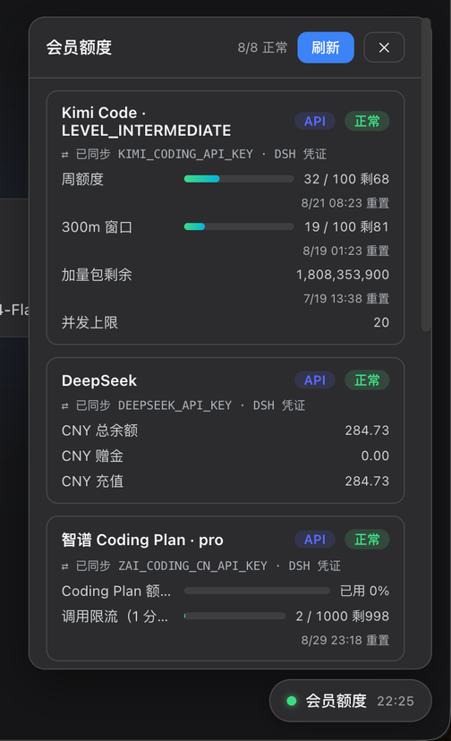

[简体中文](./README.md) | **English**

# dsh-quota

**Multi-platform plan quota, API balance, burn-rate pacing radar, and event-time spend ledger for DeepSeek Harness (DSH).**



## Why dsh-quota?

| Capability & Security Dimension | `dsh-quota` | Local-Ledger-Only Plugins | HTTP-Template-Only Plugins |
|---|---|---|---|
| **Official API direct query** (DeepSeek, Kimi Code, Zhipu, Volcengine Ark, OpenRouter, xAI, OpenAI/Anthropic Admin…) | Yes (55+ platforms, multi-account per key ref) | No (estimates from local tokens only) | Partial (manual JSON path setup) |
| **Cookie / Web-console platforms via MCP fallback** (BigModel, Qianwen, Scnet, TokenRouter, SupaWriter + custom `mcp__*`) | Yes (with 1-click browser sign-in renewal) | No | No |
| **Local Magpie gateway deduplicated sync** (Codex / Claude / Grok / Gemini windows + local subscription dedup) | Yes | No | No |
| **Reset-aware window pacing radar** (`etaMinutes` vs `resetAt` — suppresses pre-reset false alarms, flags weekly over-pace) | Yes | No | Rare |
| **Event-time session & 3-tier daily ledger** (locks price at call time, DeepSeek UTC+8 off-peak 50% + CN holidays, adaptive `¥ / $`, fork-deduped) | Yes | Yes | No |
| **Dual non-clipping UI entry** (`conversation.composer.dock` ambient bar + draggable pill/ring with `both / dock-only / floater-only`) | Yes | Dock or sidebar | Overlay or sidebar |
| **Hardened security boundary** (DSH credentials domain, zero plaintext keys in settings, `assertPublicHttpsUrl` SSRF & redirect guard, CSRF header) | Yes | N/A | Often missing redirect/private-IP guards |
| **Zero idle LLM context tax** (`exposeAgentTool: false` by default — 0 tool-schema tokens per turn unless opted in) | Yes | Varies | Varies |

## Highlights

- **Ambient Composer Dock + Draggable Pill/Ring**: Displays the active session model's tightest quota window and live session cost right beneath the composer (`conversation.composer.dock`, immune to sidebar overflow clipping), paired with the draggable overlay pill/ring (`both` by default; switchable to `dock-only` or `floater-only`, automatically falling back to the pill on non-chat pages).
- **Tightest-Window Headline & Reset-Aware Pacing**: Multi-window plans (5h + weekly + monthly) always surface the highest-risk window first. Depletion ETAs are compared against `resetAt` so windows resetting in 8 minutes never fire false alerts, while weekly plans burning faster than their reset window show an amber `⚠ Pace exceeds reset window` warning.
- **Event-Time Session Ledger & 3-Tier Daily Rollup**: Host-side incremental accounting locks each step's cost at completion time (switching models never rewrites past turns), applies DeepSeek off-peak (50%) & weekend/holiday pricing automatically, adapts `¥` / `$` currency per provider family, counts context compaction & `web_search` calls, and rolls up **This session · Today (workspace) · Today (all)** without double-counting `subagent_fork` history.
- **Zero-Config Sync & 2-Click Relay Onboarding**: Automatically picks up API keys already configured in DSH model settings (`apiKeyEnv`). On fresh installs with only third-party OpenAI/NewAPI relays configured, detects untracked HTTPS routes and pre-fills custom quota cards in two clicks.
- **Actionable Redacted Diagnostics & URL Overrides**: Built-in `PASS / FAIL` diagnostics classify 401/403 (e.g. Admin Key vs model key)/404/429/`missing-mcp` with secret-scrubbed copyable reports, and `endpointOverrides` lets you recover from upstream domain migrations while preserving strict SSRF and no-redirect enforcement.

## Installation

```sh
dsh plugin --profile web add dsh-quota
```

Or open **Settings → Plugins** in DSH Web GUI and install `dsh-quota`.

## Optional Configuration (`cordis.patch.yml`)

```yaml
- id: quota
  config:
    refreshOnBoot: true          # Refresh once shortly after startup (default: true)
    refreshIntervalMinutes: 5    # Periodic refresh interval in minutes, 0 disables (default: 5)
    alertPercent: 85             # Red-badge usage threshold percentage (default: 85)
    exposeAgentTool: false       # Expose `quota_refresh` to LLM Agent (default: false to save context tokens)
    endpointOverrides: {}        # Override built-in adapter HTTPS origins/URLs on vendor host migration
```

For custom HTTP aggregators (`openai-billing` / `newapi-account`) and custom MCP quota tools (`mcpPlatforms`), see **[docs/extending.md](./docs/extending.md)**.

## Development

```sh
pnpm install
pnpm link-harness   # Link @deepseek-ai/* types from installed dsh (falls back to vendor/)
pnpm test           # Run unit & security test suite
pnpm typecheck      # Strict TypeScript check (including session/slot compile-time canaries)
pnpm build          # Bundle Host ESM + Browser CJS with client-id & bundle-meta gate
```

## License

MIT
