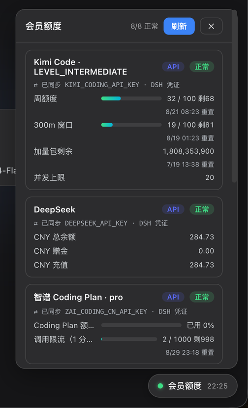
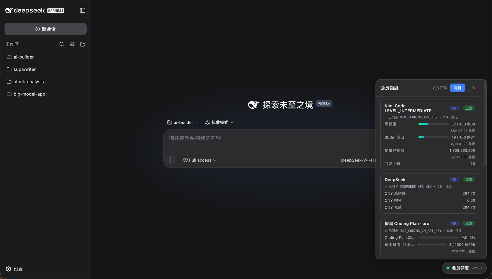
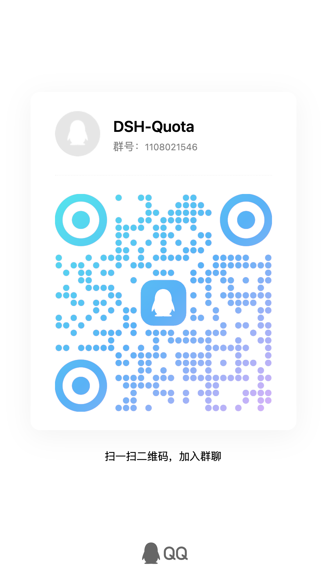

# dsh-quota

DeepSeek Harness 插件：右下角「会员额度」悬浮球 + 面板，一眼看清各 AI 平台的套餐额度与余额。



<details>
<summary>📸 整页效果（悬浮球在右下角）</summary>



</details>

**截图里都是什么：**

- **右下角的「会员额度」悬浮球**：圆点表示整体状态（绿 = 全部正常 / 黄 = 部分异常 / 红 = 全部失败），旁边是上次刷新时间；点击展开/收起面板，打开时数据超过 5 分钟会自动后台刷新；**按住可拖拽到屏幕任意位置**（位置自动记住，拖到上半屏时面板改为向下展开）
- **每个平台一张卡片**：右上两个徽标——`API` = 官方 API 直查（key 自动同步自 DSH 凭证域，下方灰色小字显示用的是哪个凭证引用，例如 `⇄ 已同步 KIMI_CODING_API_KEY · DSH 凭证`），`MCP` = 通过已注册的 MCP 服务器查询；`正常` / `失败` / `未配 Key` 是本次查询状态
- **彩色进度条**：用量占比（<60% 绿 / 60–85% 黄 / >85% 红），右侧是 `已用 / 上限 剩xx`，下方小字是额度窗口的重置时间
- **头部「刷新」按钮**：立即重新查询所有平台；面板底部「API Key 管理」折叠区可手动补 key（一般不需要——DSH 里加过的 key 会自动同步过来）

## 功能

- **定时自动更新**：默认每 5 分钟刷新一次（`refreshIntervalMinutes` 可调）；打开面板时数据超过 5 分钟也会自动补刷；手动「刷新」随时可用
- **进度条可视化**：用量占比彩色进度条（<60% 绿 / 60–85% 黄 / >85% 红），带重置时间
- **配置哪些显示哪些**：只有 key 能解析（或 MCP 已注册）的平台才显示，没配置的平台不占面板
- **当前平台优先**：面板里「当前在用」的模型所属平台的卡片自动排到最前（紧跟第一行的「本会话」用量卡片），换模型时顺序实时跟着变；其余平台仍按内置顺序（直连 API 在前、MCP 兜底在后）。供应商 → 平台的映射表只有一份（`src/platform-map.ts`，Host 与浏览器共用），火山方舟 `ark → volcark` 这类规则不会再出现「只有一侧认得」的漂移
- **手动排序**：面板头部「排序」按钮进入排序模式，每张卡片右侧出现 ▲▼，按平台整组移动（同平台多账号、magpie 多线路会一起走），松手即自动保存。手动顺序优先于「当前在用置顶」——只要手动顺序里包含当前平台，它就不再跳回最前；没有手动排过的平台仍按内置顺序排在后面。顺序按**平台组 key**记录（`deepseek` / `magpie-commandcode` / `aihub` 这种组名，不含 `#凭证` 后缀），所以换 key、加第二个账号、magpie 换线路都不影响位置。
- **本会话用量可折叠**：面板第一行「本会话」默认收起，只显示模型与估算花费；点标题展开输入 / 缓存读 / 输出 token、估算成本与计费周期行（展开状态会记住）。**只要屏幕上有会话这张卡就在**——还没产生用量时收起行显示「本会话还没有产生 token 用量」、展开行三桶为 0，不会整块消失。余额型平台的计费周期行在样本不足 7 天时只报「近 N 天实测 + 日均」，不再把日均外推成「近 7 天总额」
- **Key 自动同步**：直连平台的 API key 直接读 DSH 凭证域（与模型配置同一批 `apiKeyEnv` 引用）——DSH 里加过 key 就不用手动再填；凭证变更自动触发刷新
- **同平台多账号**：同一平台在 DSH 里挂了第二个模型供应商（例如再建一个 `deepseek-b` 路由，`apiKeyEnv` 指向 `DEEPSEEK_B_API_KEY`、baseURL 填官方地址），面板会按凭证引用出**第二张卡**，标题用 `· deepseek-b` 区分，两张卡各查各的 key、互不覆盖。注意 DSH 本身一个供应商只有一个 `apiKeyEnv`——在同一个供应商卡片里重复填 key 是**覆盖**，不是新增账号；第三方兼容网关（baseURL 不是官方域名）也不会被拿来查官方余额接口
- **手动 Key 兜底**：面板里可手动保存 key（存于 DSH 凭证域的插件私有引用，删除不影响 DSH 模型配置）
- **消耗速率与剩余时长预估**：本地时序采样（≥10 分钟一个点、保留 14 天，落盘到 `$DSH_HOME/dsh-quota/history.json`，重启不清零），在当前配额窗口段上计算平均消耗速率（%/h），条目下方给出「约 x 小时后耗尽」预估；窗口重置自动截断分段，不会跨重置算出错误速率；`quota_refresh` 工具同步透出
- **余额型平台的「近 7 天消耗 / 余额还能撑多久」**：余额条目按**日历时间**口径算——近 7 天实测余额降幅 ÷ 跨度（闲置时间也算进分母）得到真实日均，再外推 7 天花费与余额耗尽时间。样本跨度不足 24 小时不显示（几十分钟的活跃速率外推一周会放大 3 倍左右，这正是「日均 ¥20 却被算成 ¥430/周」的来源）；跨度不足 7 天会标注「按 N 天实测折算」
- **一键测活**：每张卡片右上「测」按钮当场重跑该平台的查询，返回毫秒延迟（`✓ 320ms`）或上游原始错误；只读探测，不改动快照
- **自定义端点安全校验**：接口地址必须是公网 HTTPS——拒绝内嵌用户名/密码、查询参数、`localhost`/`.local`/`.internal` 与回环/私有/链路本地/保留地址（含 IPv4/IPv6 字面量）；请求拒绝跟随 3xx 跳转、响应超过 256 KiB 直接失败，避免自定义平台被用来探测内网
- **中英双语界面**：面板文案跟随 DSH 的语言设置（`ctx.locale` 服务）实时切换，缺失该服务时按浏览器语言自动判定；药丸/悬浮环/面板/错误提示/时间格式全部本地化（en 文案不含中文字符，有单测把关）
- **红点告警 Badge**：悬浮球/悬浮环右上角红点计数——查询失败的平台 + 用量占比 ≥ `alertPercent`（默认 85，可配置）的条目 + 登录失效提醒，恢复后自动消失
- **告警已读**：点红点（或面板头部的「⚠ N 项告警」）即把当前告警标为已读，红点与卡片上的 ⚠ 一起消失，刷新页面也不再回来（localStorage 记住）。已读按「条件」记录：额度窗口重置（条目的重置时间变化）、查询错误文案变了、或条目回落后又重新越阈值，都会自动变回未读——所以它只是不再反复提醒同一件事，不会漏掉新问题
- **HUD 悬浮环模式**：面板头部一键在「药丸 / 悬浮环」之间切换（localStorage 记住）；悬浮环显示剩余额度环形进度（绿/黄/红三档、平滑动画），焦点跟随当前会话模型，无对应时每 4 秒轮播各平台（悬停暂停）；拖到屏幕左右边缘自动贴边微缩、悬停展开

## 支持的平台

**钉住平台**（始终显示，缺 key 时提示）：Kimi Code、DeepSeek、智谱 Coding Plan。

**自动发现平台**（key 在 DSH 凭证域/环境变量能解析就自动出现，否则隐藏）：Z.AI Coding、Moonshot、OpenRouter、SiliconFlow（国际/国内）、MiniMax Coding（国际/国内）、StepFun、xAI、OpenCode Go、DeepInfra、Venice、NeuralWatt、**OpenDesign**、**OpenAI Platform**、**Anthropic Claude**。面板「API Key 管理」覆盖全部直连平台——填 key 即接入（写入 DSH 凭证域，模型配置也能用）。

**OpenDesign（open-design.ai / Vela）**：额度同样**不在推理 API 上**——模型面 `amr-link.open-design.ai/v1` 只认 `sk-amr-…` 推理 key，没有任何额度路由；额度在**控制面** `amr-api.open-design.ai/api/v1`，且只认 `vela_ctrl_…` 控制面 key（任何网页都不印这个 key，由 vela CLI 设备授权签发）。所以凭证引用是 `OPENDESIGN_CONTROL_KEY`（别名 `VELA_CONTROL_KEY`），**不是**给模型供应商配的 `OPENDESIGN_API_KEY`：后者填进来只会得到 401，面板会直接告诉你这一点。

**查 OD 额度必须先登录 Open Design**：那把 key 由 vela 的设备授权签发，没有任何网页会显示它。所以本插件不要求你手抄 key ——它每次刷新都直接读 vela 的登录态（`~/.amr/config.json` 的 `profiles.prod.controlKey`），变了就写回 DSH 凭证域，于是「在 Open Design 里登录 / 重新登录」就等于「面板恢复」，key 轮换也自动跟上。没登录时卡片不会消失，而是钉住显示「需要先登录 Open Design（vela CLI / 桌面版）才能查额度」，卡片上的灰字会写明本次读数用的是「Open Design 登录态」还是「DSH 凭证域」。查询路径：`GET /workspaces/current` 解析 workspaceId → `GET /workspaces/{id}/billing/preflight` 取额度窗口与钱包 → `GET /billing/summary` 补累计消费（拿不到只少一行）。卡片显示 `7 天窗口`（credits 与折算 USD）、**钱包余额**（负数即欠费，照实显示）、累计消费；窗口各自独立、**绝不相加**。多工作空间时用环境变量 `OPENDESIGN_WORKSPACE_ID` 钉住。注意别用 `/billing/coding-plan-usage`——那个端点对控制面 key 返回 401，`preflight` 才是能用的。

**火山方舟（Volcengine Ark）**：额度**不在推理 API 上**——`ARK_API_KEY`（`ark-…`）只能调模型，所以 DSH 里只配了它时，卡片只能探活显示「模型服务 在线」，这是设计如此、不是查询失败。套餐用量要走火山引擎**控制面 OpenAPI**（`open.volcengineapi.com`，`GetCodingPlanUsage` / `GetAgentPlanAFPUsage`，HMAC-SHA256 签名），必须用 **AccessKey ID + SecretAccessKey**：在面板底部「API Key 管理」里把两者按 `AK:SK`（或控制台给的合成串 `AK/SK`、整行 `AccessKeyID/SecretAccessKey: …`）填进「火山方舟 (AK/SK)」，插件会自动拆开，或直接写凭证引用 `VOLC_ACCESS_KEY_ID` / `VOLC_ACCESS_KEY_SECRET`（也认 `VOLC_ACCESS_KEY` / `VOLC_SECRET_KEY` 等别名）。AK/SK 建议用 IAM 子用户并只授 `ArkReadOnlyAccess`（只读）；Coding Plan 与 Agent Plan 共用同一对 AK/SK，插件先试 Coding Plan、未订阅时自动落到 Agent Plan。

**国外官方平台（用量/成本口径）**：OpenAI 走组织 Admin API `/v1/organization/costs`（凭证引用 `OPENAI_ADMIN_KEY`，即 `sk-admin-…`），Anthropic 走 Admin `cost_report`（凭证引用 `ANTHROPIC_ADMIN_KEY`，即 `sk-ant-admin…`，请求带 `anthropic-version`、金额单位是「分」已自动换算）。两家都**没有余额查询接口**，卡片展示「今日 / 近 7 天 / 近 30 天消耗」，并在卡片上注明；普通 `sk-*` / 项目 key 会被上游拒绝，不是插件的问题。

**MCP 平台**（纯可选扩展，通过另行注册的 `mcp__*` 工具取数；本仓库不包含这些 MCP 服务器）：智谱 BigModel、通义千问（百炼）、超算互联网、TokenRouter、SupaWriter。没注册时对应平台自动隐藏。

> **智谱 BigModel 的登录态会自己续上**：该 MCP 服务器（`bigmodel-mcp`）能从本机 Chrome / Edge / Brave 的 `bigmodel_token_production` cookie 解出 JWT。面板刷新时若上游回「登录状态已过期」（code 401），它会自动重取浏览器里的新 token、写回会话文件并**重试一次**，所以你在浏览器里重新登录 open.bigmodel.cn 后，点一下刷新（或等自动轮询）就恢复，不用重启 dsh、也不用手动粘贴 cookie。

**MCP 平台行兼容 DSH 0.2.1 与 0.2.2 两种 `ctx.tools.execute` 形态**：0.2.2 把 `execute({callId,name,arguments})` 换成了整批 `execute({calls,signal})` 并把调度交给所选执行器；把旧的单调用形状发给 0.2.2 会在任何工具体运行前就被批调度器拒掉（`ToolBatchExecutionError: Tool batch execution failed`，原因是 `input.calls.map` 读不到）。Host 半边因此按运行时能力分派：存在 `selectExecutor`/`definitions`（0.2.2 起才有）就走单元素批，否则退回旧单调用；两条路都归一化成同一种结果，旧版 dsh 上行为不变。

**智谱余额用 API key 就能查，不需要登录态**：`智谱 Coding Plan` 卡（API key 直连）除了 5 小时/周窗口与搜索额度，还会显示**账户余额、累计消费**——走 `GET https://open.bigmodel.cn/api/biz/account/query-customer-account-report`（`Authorization: Bearer <key>`，返回 `balance/availableBalance/rechargeAmount/giveAmount/totalSpendAmount/frozenBalance`）。注意智谱把控制台接口也放在 `/api/biz/*` 下，但权限不同：`/api/biz/customer/accountSet`、`/api/biz/customer/getCustomerInfo` 对 API key 返回 `403 APIKey not allow access`（那才是 MCP 登录行存在的原因）；余额、订阅列表 `/api/biz/subscription/list`、资源包 `/api/biz/tokenAccounts/list/my`、用量 `/api/monitor/usage/model-usage` 都对 API key 开放。附加行取不到（403/超时）只会少一行，不会把卡片变成错误。

**平台来源以 DSH 系统配置为准**：MCP 平台行只在 **DSH composition（profile 的 `cordis.yml` / `cordis.patch.yml`）声明了对应的 `@deepseek-ai/dsh-mcp-client` 条目**时才创建——Host 半边通过 cordis loader 服务读取真实的 entry 树，而不是看项目里的 `.mcp.json`、也不是"恰好存在同名工具"；composition 里删掉条目（并重启 dsh）后，对应平台立即从面板消失。loader 服务不可用的旧版本上自动退回"工具注册表探测"。

**自定义平台**：有余额 API 的平台（聚合站 / one-api / new-api…）在面板底部「自定义平台」直接添加，或在 config 里声明 `httpPlatforms` / `mcpPlatforms` —— 详见 **[docs/extending.md](docs/extending.md)**（含"如何把网页 Cookie 平台做成 MCP 接入"的完整指南）。

NewAPI 有两种口径：`openai-billing` 使用模型 `sk-*` key 查询该 key 的额度；`newapi-account` 使用个人设置里的系统访问令牌与用户 ID 查询 `/api/user/self`，显示整个账号的余额和累计用量。

## 安装

```sh
dsh plugin --profile web add dsh-quota
```

或打开 **设置 → 插件市场**，搜索 `dsh-quota` 一键安装。

> **版本要求**：`0.8.0+` 需要 dsh `0.1.2-alpha.1` 及以上（浏览器端模块表改用
> `@deepseek-ai/dsh-client-store` platform seed）。仍在用旧版 dsh（`0.1.0-rc` 系列）
> 请锁定 `dsh-quota@0.7.x`。

## 配置（可选）

在 composition 里给条目加 config：

```yaml
- id: quota
  config:
    refreshOnBoot: true          # 启动后自动刷新一次（默认 true）
    refreshIntervalMinutes: 30   # 定时刷新间隔，0 关闭（默认 0）
    alertPercent: 85             # 用量占比告警阈值（红点计数，默认 85）
```

### 接入你自己的 MCP 平台

除了上述内置平台，composition 里声明 `mcpPlatforms` 即可把任何已注册的 `mcp__*` 额度工具接进面板（通用解析：自动识别 used/limit/remaining 形的配额行与 balance 形余额；未注册时该行自动隐藏）：

```yaml
- id: quota
  config:
    mcpPlatforms:
      - id: mysite
        label: 我的平台
        tools: ['mcp__mysite__my_quota']   # 按序调用，可多个
```

## 开发

```sh
pnpm install
pnpm link-harness # 把类型/依赖对齐到本机已安装的 dsh（见下）
pnpm build        # 构建 host + client，含 client-id 一致性门禁
pnpm typecheck
sh scripts/reload.sh   # 构建；Host 改动重启 dsh 生效，界面改动刷新页面生效
```

`pnpm link-harness` 默认从**本机已安装的 dsh**（`npm root -g`，或 `DSH_INSTALL=<dsh 目录>`）
软链 `node_modules/@deepseek-ai/*`，让 `typecheck`/`build` 与运行时解析同一份代码。
改 dsh 源码时才用 `sh scripts/link-harness.sh --harness [checkout 路径]` 切到工作树构建。
两者都没有时回退到仓库内 `vendor/`（schemastery / cordis / dsh-client-store）。

## 交流群

扫码加入 QQ 交流群，一起反馈问题、分享用法、共建插件——欢迎一起来建设！



## License

MIT
